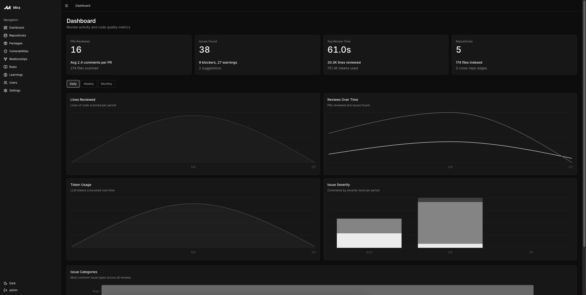
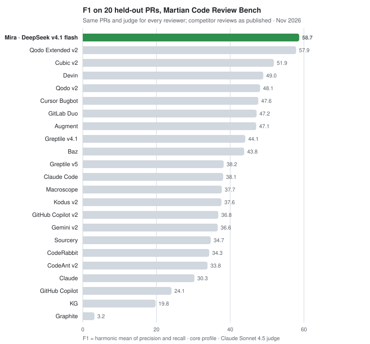

<p align="center">
  
</p>

<h1 align="center">Mira</h1>

<p align="center">
  <strong>Self-hosted AI code review. Your code, your dashboard, your LLM key.</strong>
</p>

<p align="center">
  <a href="https://docs.miracode.ai"></a>
  <a href="https://discord.gg/uEU6qvYhgm"></a>
</p>

<p align="center">
  <a href="https://docs.miracode.ai">Docs</a> ·
  <a href="https://discord.gg/uEU6qvYhgm">Community</a> ·
  <a href="https://docs.miracode.ai/deployment"><strong>Self-Host Guide »</strong></a> ·
  <a href="#benchmark">Benchmark</a>
</p>

Self-host every feature: full review engine, codebase indexing, vulnerability scanning, custom rules, org-wide package search, dashboard, learning loop. No paid tier, no license key, no SaaS upsell.

Mira reviews your pull requests using your choice of LLM (via [OpenRouter](https://openrouter.ai), which fronts Anthropic, OpenAI, Google, DeepSeek, and more) and posts concise, actionable feedback. The noise filter, confidence clamping, and learning loop ensure you only see comments that matter. See [`FEATURES.md`](FEATURES.md) for the full surface.

## Why Teams Choose Mira

- **Model agnostic** — Run Claude, GPT, Gemini, DeepSeek, Llama, or any OpenAI-compatible endpoint: OpenRouter, vLLM, Ollama, Together, Groq, Fireworks, or AWS Bedrock direct. Per-provider quirks are config, not code, so adding a provider is a one-line entry.
- **Zero markup on LLM costs** — Bring your own key. You pay the model provider directly; Mira never proxies your spend or adds a multiplier. The dashboard shows real per-repo, per-model cost — not estimates.
- **Learns from your context** — Mira synthesizes rules from your merged PRs: rejected comments and human review patterns become team rules that shape future reviews.
- **You set the rules** — Define custom and org-wide review rules in plain language, per-repo via `.mira.yaml` or from the dashboard.
- **Privacy first** — Self-hosted by default. Diffs, indexes, review history, and CVE data live in your SQLite or Postgres, on infra you own. No phone-home, no required telemetry, no "is this used for training?"
- **Low-noise reviews** — Confidence thresholds, dedup, a self-critique pass, and per-PR caps mean every comment is one worth reading — Mira has the best precision of any top-tier tool on the public [Code Review Bench](#benchmark), on a model that costs cents per review.
- **Catches PRs stepping on each other** — While reviewing, Mira checks the repo's other open PRs and flags merge-conflict risk and duplicate effort right in the walkthrough.
- **Indexed, cross-file context** — A full-repo code index gives the model real project context, not just the diff — plus org-wide package search and hourly OSV.dev CVE scanning across every repo.
- **GitHub, GitLab, Forgejo, and Bitbucket Cloud** — Auto-reviews every PR and merge request and answers `@miracodeai` questions inline across GitHub, GitLab, Forgejo (incl. Codeberg), and Bitbucket Cloud. The engine, indexer, and dashboard are provider-agnostic, so a new host is a data entry plus one provider class.
- **Self-host on day one** — Docker image with Railway / Fly.io / Render configs, SQLite or Postgres. Every feature included.

## Dashboard



## Your data, your dashboard

Most AI reviewers are SaaS: your diffs (and often the full surrounding code) leave for a third-party server, and the only "view" you get is the comments that come back on a PR. Mira flips both halves of that:

- **Your code never leaves your infra.** Diffs, embeddings, indexes, review history, vulnerability data, all stored in your SQLite or Postgres, on infrastructure you own. No phone-home, no required telemetry, no "is this used for training?" question.
- **The dashboard you see above is yours.** It's not a marketing screenshot of someone else's view of your code. CodeRabbit, Greptile, and similar SaaS reviewers don't expose anything like it. Mira's dashboard surfaces signals you don't get anywhere else:
  - **Org-wide package inventory**: answer "which repos use `lodash@4.17.20`?" in one query. Stack it next to your CVE feed for instant blast-radius checks.
  - **CVE alerts on every dependency**: hourly OSV.dev poll, severity + advisory link + fix version surfaced inline next to the package.
  - **Dependency + blast-radius graphs**: see exactly which files and repos depend on a symbol before you change it.
  - **Per-repo review event stream**: every webhook, every chunk, every cost figure, in one place for live troubleshooting.
  - **Cost & token telemetry**: actual spend per repo and per model, not estimates, because you control the LLM key.
  - **Review-health page**: stale/waiting PRs, a reviewer-responsiveness leaderboard, throughput trends, and rubber-stamp detection (approvals with no substantive review) — plus per-contributor analytics with a year-long heatmap and Mira's review-quality signal.
  - **Coming soon, change-frequency heatmaps**: surface the files that bug fixes keep landing on so you can target review attention.

If your engineering team needs answers like *"which of our repos are exposed to this CVE?"* or *"what's the blast radius of changing this function?"*, those questions stop being multi-day investigations and start being one-click dashboard pages.

## Benchmark

On a **20-PR held-out sample** of the public [Martian Code Review Bench](https://github.com/withmartian/code-review-benchmark/tree/e616e849755441da38f18bf3adba2c9583b03803/offline), Mira running an inexpensive model (**DeepSeek v4.1 flash**) ranks **first on F1 of 23 published reviewers**, with the highest precision of any tool above 50% recall. Run on 6 November 2026.

<picture>
  <source media="(prefers-color-scheme: dark)" srcset=".github/assets/benchmark-f1-dark.svg">
  
</picture>

| Reviewer | Precision | Recall | F1 | TP / FP / FN |
|---|---:|---:|---:|---|
| **Mira · DeepSeek v4.1 flash** | **68.1%** | 51.6% | **58.7** | 32 / 15 / 30 |
| Qodo Extended v2 | 63.5% | 53.2% | 57.9 | 33 / 19 / 29 |
| Cubic v2 | 47.9% | 56.5% | 51.9 | 35 / 38 / 27 |
| Devin | 66.7% | 38.7% | 49.0 | 24 / 12 / 38 |
| Qodo v2 | 45.1% | 51.6% | 48.1 | 32 / 39 / 30 |
| Cursor Bugbot | 58.1% | 40.3% | 47.6 | 25 / 18 / 37 |
| GitLab Duo | 47.5% | 46.8% | 47.2 | 29 / 32 / 33 |
| Augment | 49.1% | 45.2% | 47.1 | 28 / 29 / 34 |
| Greptile v4.1 | 43.1% | 45.2% | 44.1 | 28 / 37 / 34 |
| Claude Code | 37.5% | 38.7% | 38.1 | 24 / 40 / 38 |
| GitHub Copilot v2 | 28.6% | 51.6% | 36.8 | 32 / 80 / 30 |
| CodeRabbit | 27.1% | 46.8% | 34.3 | 29 / 78 / 33 |

The full ranking of all 23 reviewers, per-PR results, settings and commit pins are in [`benchmark-results.json`](.github/assets/benchmark-results.json).

**Speed:** all 20 reviews completed; median **107 seconds** per PR (70–544 s), 13 of 20 under two minutes, including a 106-file Sentry PR in 114 s. Timing covers Mira's full pipeline on an empty index and excludes snapshot preparation and judging. Competitors publish no timings for this sample, so there is no speed comparison.

**Method.** The sample is entries 1, 2, 4 and 5 of each repository's golden file in the pinned upstream checkout: four PRs each for Python (Sentry), Go (Grafana), TypeScript (Cal.com), Ruby (Discourse) and Java (Keycloak), 62 reference issues in the **core** profile. It was fixed by rule before any review, and it excludes the third entry of each file, the five PRs used during development. Mira reviewed each PR once at its pinned head commit with medium reasoning, a 16,384-token output limit, shipping defaults, and no index, learned rules or history. Matching and deduplication use the upstream benchmark's own prompts with **Claude Sonnet 4.5** as the judge; competitor rows are the upstream's published evaluations of the same PRs under the same judge and were not rerun. Unmatched findings count as false positives even where the reference set omits a valid issue.

**Caveats.** One attempt per PR: on the five-PR development sample, identical code moved by several F1 points between runs, so the 0.8-point lead over Qodo Extended v2 is not a meaningful gap, and the result is best read as "top tier with the best precision". Reproduce with [`scripts/prepare_benchmark_inputs.py`](scripts/prepare_benchmark_inputs.py) and [`scripts/run_five_pr_benchmark.py`](scripts/run_five_pr_benchmark.py); the chart comes from [`scripts/render_benchmark_charts.py`](scripts/render_benchmark_charts.py).

## Quick Start

Run Mira self-hosted to auto-review every PR and merge request and answer `@miracodeai` questions inline. GitHub (as a GitHub App), GitLab (via a group/project access token), Forgejo/Codeberg (via an access token), and Bitbucket Cloud (via an access or API token) are all supported.

**1. Deploy** — one-click on Railway, or with Docker:

[](https://railway.com/workspace/templates/05874bad-2d98-43f4-aa93-332f394e9ebd)

```yaml
# mira.yaml — deployment-wide defaults. Every key is optional.
llm:
  model: "anthropic/claude-sonnet-4-6"
  indexing_model: "anthropic/claude-haiku-4-5"
```

```bash
# .env — secrets only.
MIRA_GITHUB_APP_ID=123456
MIRA_GITHUB_PRIVATE_KEY="$(cat private-key.pem)"
MIRA_WEBHOOK_SECRET=your-secret
OPENROUTER_API_KEY=sk-or-...
```

```bash
docker run -p 8000:8000 --env-file .env \
  -v "$(pwd)/mira.yaml:/app/mira.yaml" \
  ghcr.io/miracodeai/mira:latest --config /app/mira.yaml
```

**2. Install the app** on your repos — every PR gets reviewed.

**Bitbucket Cloud** — instead of the GitHub App creds, set:

```bash
# A workspace/project/repository access token (Bearer), or an API token as email:token.
# Scopes: repository read, pull requests read+write, webhooks read+write.
MIRA_BITBUCKET_TOKEN=ATCTT3x...
MIRA_BITBUCKET_WEBHOOK_SECRET=your-secret
MIRA_BITBUCKET_WORKSPACE=your-workspace   # optional: dashboard repo discovery scope
MIRA_BITBUCKET_BOT_USER=mira              # optional: bot nickname if the token can't read /user
```

Then add a workspace (or repository) webhook pointing at `https://<mira-host>/bitbucket/webhook` with the same secret and the triggers *Repository: Push*, *Pull request: Created, Updated, Merged, Comment created*. Bitbucket PRs have no labels, so `@mira pause` state is kept in Mira's database. Comment commands check repository permission through the workspace permissions API, which needs admin rights; otherwise list reviewers' account ids in `commands.allowed_users`. Bitbucket nicknames are not unique, so authorization and the allowlist match the commenter's account id, never the nickname.

→ Full walkthrough: [creating the GitHub App & quickstart](https://docs.miracode.ai/quickstart) · [GitLab setup](https://docs.miracode.ai/gitlab) · [deploy options](https://docs.miracode.ai/deployment) · [choosing models, custom endpoints & AWS Bedrock](https://docs.miracode.ai/configuration/models)

### Codex CLI

If you already use OpenAI Codex locally, Mira can run reviews through the
Codex CLI instead of an HTTP API key. Authentication stays inside Codex via
`CODEX_HOME/auth.json`, created by `codex login`:

```yaml
# mira.yaml
llm:
  provider: "codex-cli"
  model: "codex-default"      # use the Codex CLI default model
  codex_home: "/run/codex"    # optional; defaults to CODEX_HOME
  codex_sandbox: "read-only"  # the only accepted sandbox policy
  codex_timeout_seconds: 900  # optional
```

The official Mira image includes a pinned Codex CLI. Mount a Codex login read-only:

```bash
docker run -p 8000:8000 --env-file .env \
  -e CODEX_HOME=/run/codex \
  -v "$HOME/.codex:/run/codex:ro" \
  -v "$(pwd)/mira.yaml:/app/mira.yaml:ro" \
  ghcr.io/miracodeai/mira:latest --config /app/mira.yaml
```

This provider does not require `OPENROUTER_API_KEY`. Mira copies only `auth.json`
from the read-only mount into a private, writable temporary Codex home for each
invocation. It launches Codex in an empty temporary workspace with a minimal
environment, disables inherited shell environment variables and user/project
rules, and enforces the read-only sandbox.
Provider choice, executable/auth paths, sandbox policy, and timeout are
deployment-only settings; repository `.mira.yaml` files cannot override them.
For one-shot `mira review` runs, `--config` is treated as untrusted by default.
An operator-owned config may opt in with `--trust-execution-settings`; never use
that flag with a repository-controlled file.

Codex CLI does not expose Mira's temperature or hard output-token controls, so
Mira disables ensemble sampling for this provider. The mounted OAuth session is
still a sensitive deployment credential: use a dedicated Codex account/session
and isolate the Mira container from unrelated host files and services.

## Configuration

`mira.yaml` (loaded via `--config`) holds deployment-wide defaults. Drop a `.mira.yaml` in any repo — or use the dashboard — to override per-repo; both deep-merge over `mira.yaml` for that repo only:

```yaml
# .mira.yaml — optional per-repo override
filter:
  confidence_threshold: 0.5  # noisier repo → lower bar
  max_comments: 10
```

→ Full schema and every key: [Configuration docs](https://docs.miracode.ai/configuration).

## Development

```bash
git clone https://github.com/miracodeai/mira.git
cd mira
pip install -e ".[dev,serve]"

# Run tests
pytest tests/ -v

# Run the regression suite (hits real GitHub + LLM, ~$1, ~3 min).
# Pinned PRs whose findings have flickered across iterations. Run before
# merging changes that touch prompts, the noise filter, or the engine.
OPENROUTER_API_KEY=... GITHUB_TOKEN=... pytest -m eval -v

# Lint
ruff check src/ tests/

# Type check
mypy src/mira/ --ignore-missing-imports
```

## License

Apache 2.0. See [LICENSE](LICENSE).
